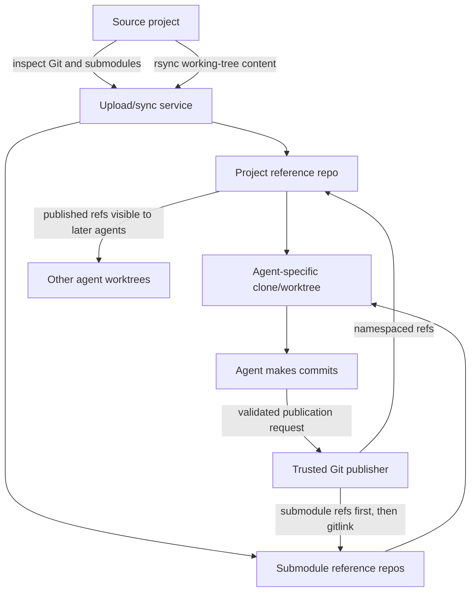
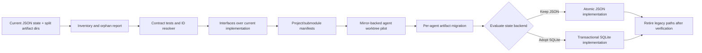

# Agent Management and Project Workflow: Architecture Proposal

This document captures a proposal for discussion, not an instruction to immediately rewrite the current implementation. The goals are to make agent management predictable, keep one authoritative source of state, support local and remote implementations through shared contracts, and provide an incremental migration path.

## Goals and principles

- Use one source of truth for agent lifecycle state and identity.
- Keep agent-owned artifacts discoverable and cleanable under a canonical per-agent root.
- Resolve full IDs and unique shortened prefixes consistently across local, remote, and batch operations.
- Preserve submitted patches and other review evidence until they have an explicit disposition.
- Share interfaces and behavior across local and remote implementations while allowing different transports and storage backends.
- Separate project Git repositories, model-provider integrations, and agent lifecycle/state concerns.
- Make failures observable, recoverable, and covered by tests before replacing existing components.

## Proposed deployment layout

Keep application code and runtime versions shared. Give each agent a canonical directory containing its state and agent-owned artifacts:

```text
~/tgent-deploy/
├── app/                              # Shared application
├── runtime/                          # Shared, versioned runtimes
├── projects/
│   └── <project-id>/
│       ├── mirror.git/               # Bare project reference repo
│       └── submodules/
│           └── <path-id>.git/        # One mirror per submodule path
├── uploads/
│   └── staging/<upload-id>/          # Temporary; not an agent yet
└── agents/
    └── <canonical-agent-id>/
        ├── state/
        │   ├── record.json           # Authoritative current state
        │   └── history.jsonl         # Conversation/event history
        ├── worktree/
        ├── snapshot/
        ├── logs/
        └── patches/
```

The state record is the source of truth for whether an agent exists, its state, patch disposition, and the locations/status of its artifacts. The other directories hold artifacts and can be cleaned up when an agent is safely reaped. The project mirror is shared by the project, not owned by an individual agent. Upload staging remains separate because it is keyed by upload ID and becomes an agent only when finalization creates the agent record and directory.

Reaping should retain a minimal `reaped` state record (a tombstone), rather than erase the identity entirely. This supports retries, audit, and unambiguous “already reaped” responses. Reaping removes eligible artifacts and records their results in the tombstone.

JSON can remain the initial state representation. Atomic temp-file-plus-rename writes, locking, schema/version rules, and recovery behavior are still required. SQLite should be evaluated separately as an implementation behind the state interface, not treated as a prerequisite for clarifying lifecycle semantics.

## Interface 1: project Git upload and working-tree synchronization

### Purpose

Maintain one reference repository per project and one per submodule path, while giving each agent an independent writable worktree. Uploading the working directory should preserve the uncommitted and untracked project changes required for the task.

### Proposed contract

```text
ProjectRepository
  ensure_project(project_identity, source)
  sync_working_tree(project_id, source, sync_policy) -> SyncResult
  create_agent_worktree(project_id, agent_id, base, sync_result) -> Worktree
  list_published_refs(project_id, scope)
  publish_commits(project_id, agent_id, commits, expected_base) -> PublishedRefs
  fetch_published_refs(project_id, worktree, scope)
  inspect_project(project_id) -> ProjectManifest
```

The shared contract should define:

- **Project identity:** stable across uploads and agent starts; not inferred only from a transient checkout path.
- **Base revision:** source commit/ref used for the worktree.
- **Working-tree sync policy:** treatment of ignored and untracked files, deletions, permissions, symlinks, and `.git` metadata. Git metadata must not be blindly copied by `rsync`.
- **Result manifest:** source revision, sync policy and paths, project identity, and discovered submodules.
- **Publication scope:** which agent-published commits/refs are visible to other agents.
- **Failure semantics:** incomplete sync or publication must not appear successful or leave a misleading ref.

Local and remote implementations may use different transports, but must return the same result model and enforce the same policy.

### Reference repositories, worktrees, and publication

An agent worktree can be cloned using the project mirror as a reference object store. Each agent gets its own refs and writable worktree; the shared mirror must not be writable by the agent. The controller or a dedicated trusted Git service validates and publishes agent commits into namespaced refs, for example:

```text
refs/agents/<agent-id>/<publication-id>
```

Agents must not be able to overwrite project default branches or another agent's refs. Publication should use compare-and-swap semantics for ref updates, be idempotent, and retain published objects while other agents may reference them.

A read-only-mounted mirror cannot also be pushed to directly by an agent. The controller or Git service receives and validates publication requests. Read-only access is appropriate for the object store; publishing is a separate, controlled operation.

Published refs allow later agents to fetch another agent's commits even if those commits have not been merged into the project's main branch. Distinguish clearly between:

- The original project base
- A commit published by an agent
- A commit merged into a project branch
- A patch submitted for human review

### Submodule policy

Use one reference repository per submodule **per project path**, as proposed. The project manifest associates each submodule path with its mirror and pinned gitlink revision. The sync process should:

1. Parse `.gitmodules` and the checked-out gitlinks.
2. Resolve and validate each submodule URL against policy.
3. Ensure/fetch that submodule's project-scoped mirror.
4. Create its agent worktree at the pinned gitlink revision.
5. Sync that submodule's working-tree changes without overwriting its Git metadata.
6. Publish submodule commits before publishing a superproject commit that references them.

Nested submodules should be represented recursively in the manifest. A superproject commit must not become visible before its referenced submodule commits have been published and retained. Missing, unreachable, or disallowed submodule sources should fail clearly rather than silently produce a partial checkout.

### Git upload and publication flow



## Interface 2: agent loop and model provider

### Purpose

Separate the agent control loop from the model vendor. The same task, tool policy, history, and lifecycle behavior should work with OpenAI, GitHub Copilot, or another provider.

### Proposed contract

```text
AgentLoop
  start(agent_context)
  run_until_waiting_or_complete()
  deliver_operator_messages(messages)
  request_stop(reason)
  get_runtime_status()

ModelProvider
  complete(canonical_request) -> canonical_response
  cancel(request_id)
  capabilities() -> ProviderCapabilities
```

The loop owns orchestration: conversation state, tool calls, limits, waiting for operator input, and patch-submission decisions. A provider adapter translates between the canonical request/response format and the provider API.

The canonical format should cover:

- Messages and tool calls/results
- Provider/model identity and request IDs
- Usage and budget information, when available
- Cancellation and timeout behavior
- Errors, retries, and rate-limit signals
- Provider capabilities, including unsupported features

Provider-specific fields may be retained as opaque metadata, but the control loop must not depend on them. Tool execution remains controlled by the controller, not the model provider. A model requesting a tool is not authorization to execute it; controller allowlists and sandbox policy remain authoritative.

A local implementation can run the loop in the controller process and call a locally configured provider adapter. A remote implementation can run the same loop in the remote service and expose start/status/continue/stop operations over the existing remote boundary. The boundary should carry canonical messages and events, not vendor-specific objects or live process handles.

## Interface 3: agent state and lifecycle

### Purpose

Give local and remote agents the same lifecycle and selection behavior. Callers should not need different rules for local JSON state, remote state, or a future SQLite implementation.

### Proposed contract

```text
AgentStateStore
  create(record)
  get(agent_id)
  list(scope, filters)
  resolve_id(requested_id, scope) -> canonical_id
  transition(agent_id, expected_revision, new_state, changes)
  append_history(agent_id, messages)
  record_publication(agent_id, publication)
  begin_reap(agent_id, expected_revision)
  finish_reap(agent_id, artifact_results)
```

`transition` should use a revision or equivalent compare-and-swap check so concurrent updates cannot silently overwrite one another. The filesystem JSON implementation can provide this with locking and atomic replacement; a database implementation can use transactions.

### Identifier resolution

Resolve against canonical IDs stored in the authoritative state source—not directory names discovered in `logs/`, `patches/`, or `snapshots/`.

For each request:

1. Validate that the requested form is a supported full ID or hexadecimal prefix.
2. Read canonical IDs from the scoped state store.
3. Return an exact full-ID match first.
4. Otherwise return a unique prefix match.
5. Return clear `unknown` or `ambiguous` results; never choose arbitrarily.
6. Pass the canonical ID to all downstream operations.

The IDs currently seen in this deployment are 32 hexadecimal characters and are not necessarily SHA-1 hashes (SHA-1 IDs are normally 40 hex characters). Use “agent ID” unless the implementation explicitly defines these as commit hashes.

Selection logs should record:

- Operation and requested ID
- Scope/controller queried
- Candidate canonical IDs actually considered
- Match type: exact, prefix, none, or ambiguous
- Selected canonical ID, if any

This makes the “which IDs is it iterating over?” question directly answerable. Remote resolution should occur in the authoritative state service before full-ID-only validators run.

### Lifecycle, patches, and cleanup

Model lifecycle state and worker state separately where useful. For example, `halted` with `stop_reason=awaiting_command` differs from a completed, stopped agent. An inactive worker is not sufficient evidence that the agent is disposable.

A submitted patch must have an explicit disposition, such as imported, applied, rejected, or retained for review. Until then, its artifact and the information needed to review it must be protected.

Reaping should be recoverable: record intent before deleting artifacts, remove only artifact paths owned by that agent, and retain enough state to retry after a crash. Batch reap should return a per-ID result and continue after independent failures; it must not silently skip an ID or conflate “invalid ID” with “ineligible state.”

```mermaid
stateDiagram-v2
    [*] --> active
    active --> waiting: worker awaits operator
    active --> stopped: worker stopped
    waiting --> active: continue
    waiting --> stopped: explicit stop/abandon
    stopped --> reaping: eligible and patch disposition checked
    reaping --> reaped: artifacts removed or retained by policy
    reaping --> stopped: cleanup failed; retry is safe
    reaped --> [*]
```



## Migration path

Establish and test the contracts first, then change storage and layout behind them:

1. **Inventory and baseline.** Document the current record schema and map each record to its snapshot, log, patch, upload, and project checkout. Produce a read-only report of missing records and orphan artifacts. Do not delete anything during inventory.
2. **Specify and test ID resolution.** Add exact-ID, unique-prefix, ambiguous-prefix, and no-match tests. Add structured candidate logging. Exercise local and remote APIs, including batches, so validation cannot reject prefixes before resolution.
3. **Introduce interfaces around the current system.** Implement adapters over the existing JSON store, directories, Git handling, and remote service. Keep current on-disk locations; avoid a storage migration and API rewrite at the same time.
4. **Create project/submodule manifests.** Record project identity, mirror location, submodule paths, URLs, pinned revisions, and sync policy. First run this in report-only mode against existing projects.
5. **Add the mirror-backed Git workflow.** Build or import a project mirror, verify it, and create one agent worktree in a test deployment. Test dirty/untracked working trees, submodules, publication, and fetching another agent's commit not merged into main.
6. **Adopt the per-agent artifact layout.** Copy each artifact into `agents/<id>/...`, verify checksums and ownership, then atomically switch the state record to the new paths. Keep old artifacts until verification and rollback windows expire.
7. **Choose JSON or SQLite behind the state interface.** Compare operational simplicity, locking/concurrency, querying, backup, recovery, and migration. Keep the decision reversible through the interface.
8. **Remove compatibility paths only after validation.** Confirm local/remote operations, cleanup retries, patch preservation, and restart/recovery behavior before deleting legacy directories or code.

At no stage should old and new stores both accept independent authoritative writes. Migration can copy and verify data, but there must be a clear cutover point after which one store is authoritative.



## Decisions for the meeting

1. Should the canonical per-agent root be `agents/<id>/`, with `state/record.json` beneath it?
2. Which working-tree files must `rsync` transfer, especially ignored and untracked files?
3. Which submodule URL schemes and hosts are permitted, and how should credentials work?
4. Which published refs should later agents see, and how long must refs and objects be retained?
5. Should reaping retain a minimal tombstone indefinitely or for a defined period?
6. Which patch dispositions permit artifact deletion?
7. Do expected concurrency and query requirements justify SQLite now, or should we first implement the state interface over atomic JSON?

The most important near-term step is not choosing SQLite or rewriting the Git workflow. It is specifying the state and selection contracts, then adding tests and logging so current behavior is observable. That gives us evidence to decide what to fix, what to replace, and how to migrate without losing agent work.
