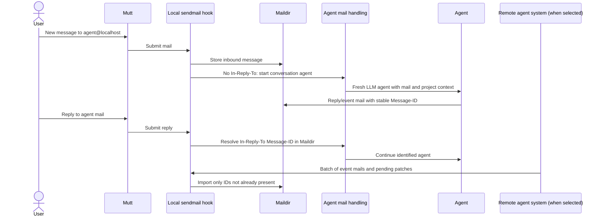

# Internal Agent Mail Workflow Proposal

This document describes a local mail interface to the agent system, built on Mutt's configured `sendmail` command and the Maildir workflow already used by `tgit_review`. This is not an Internet email service. Mail is the user-facing command and conversation format, and Maildir is where received messages are kept.

This remains a proposal; it does not prescribe an immediate implementation or replace the existing review-mail workflow without an explicit migration plan.

## Goals

- Let a user start and converse with agents by sending mail through Mutt.
- Generate a mail for each agent-system event, including events produced on the remote side.
- Route replies deterministically from the `Message-ID` being replied to.
- Keep a conversation agent's history, while distinguishing it from ordinary task agents.
- Support the existing mode switch: agents run either locally or remotely, with one active ID namespace.
- Reuse the project repository containing `mcp_agent` as the default agent context.

## Basic model

The recipient is a fixed local entry point: `agent@localhost`. It is not a per-agent address. The local sendmail implementation ingests the message and the agent-mail workflow decides whether it starts a conversation or continues one.

- A message **without `In-Reply-To`** starts a fresh, persistent conversation agent. A fresh LLM agent interprets the mail; it can reply directly or start ordinary task agents as needed. The conversation agent retains its history for later replies.
- A message **with `In-Reply-To`** is routed only by looking up the referenced `Message-ID`. It is not routed by subject, recipient guesses, or body text.
- If the referenced `Message-ID` is unknown, return a mechanical “unknown recipient” response. Do not reinterpret it as a new task.
- The default repository context is always the project root containing `mcp_agent`. The agent can choose an appropriate fresh checkout/branch (for example, based on `main`); submodules remain within that project context.

The local/remote mode is global for the active system: agents are either all local or all remote. Consequently, agent IDs and message routing use one namespace rather than separate local and remote address spaces.

## Message IDs and reply routing

Every agent-generated mail has a stable, unique `Message-ID` that identifies both the agent and the event, in this form:

```text
<agent-<agent_id>-<event_id>@localhost>
```

The angle brackets are part of the RFC-style header value; the final form has one closing `>` (for example, `<agent-a17-event42@localhost>`). `agent_id` and `event_id` must use a representation that cannot make the fields ambiguous. Re-fetching or retrying the same event must preserve the original `Message-ID`; it must not generate a new one.

On reply, the `In-Reply-To` header names this message ID. The system extracts the agent ID and looks up the referenced message in the local Maildir. It routes only when that ID is present and valid. The local Maildir is the source used to determine whether an already-fetched message ID has been seen; when fetching remote mail, fetch only messages whose IDs are not already present there. Preserve the original message and its ID when importing it.

Maildir is the durable store for mail. This design does not add a separate event ledger or notification outbox for mail delivery: stable message IDs and checking Maildir contents provide retry deduplication. The sendmail/import path must perform the ID check because Maildir itself does not guarantee deduplication by `Message-ID`.

For every meaningful agent-system event, generate a mail with its stable ID. The event mail should identify the event, agent, outcome, and any relevant patch/review reference or next action. Event mails should be generated by both local and remote agents. Remote events and pending patch submissions can be fetched in batches (for example, alongside `fetch_pending_patches`); repeated fetches retain the same IDs and are skipped if already present in Maildir. “Each event” means each event the system chooses to expose as a mail, not necessarily high-frequency internal progress such as every model token.

A conversation agent is distinguishable from ordinary task agents by its agent role/type in the agent system, not by a separate mail address or ID namespace. Its outgoing messages use its own agent ID, so replies continue that conversation. A direct reply from the conversation agent does not require starting a task agent.

## Agent names and voice

Agent roles remain stable system identifiers; friendly names and voice/persona instructions are configurable and do not affect routing or create separate ID namespaces. The defaults use a light *Roci* crew theme:

- **Naomi** — the persistent conversation agent (`conversation` role).
- **Amos** — ordinary task/work agents (`task` role).
- **Tycho** — patch integration (`integrator` role).

Voice instructions are also configurable. As an experiment, Naomi may use a light touch of Belter Creole, while keeping replies clear and avoiding an attempt to imitate it heavily or inconsistently. Other roles can have their own voice instructions or none.

## Message handling flow



## Agent lifecycle and event mails

The initial event catalog should include the lifecycle and work events already meaningful to the operator, such as:

- `agent.started`
- `agent.waiting_for_input`
- `agent.continued`
- `agent.stopped`
- `agent.failed`
- `agent.patch_submitted`
- `review.received`
- `patch_integration.started`
- `patch_integration.completed`
- `patch_integration.failed`

Each event mail gets one stable `Message-ID`; retries and remote batch fetches must retain it. `In-Reply-To` and `References` should make the mail appear in the relevant Mutt thread. Event mails should be bounded and useful: identify what happened, the agent/event, outcome, relevant patch or review, and any next action. Do not attach full agent transcripts by default.

The current local-versus-remote switch determines where agents run. In remote mode, event mails (and pending patches where applicable) are fetched and imported in batches. The importer checks Maildir for each message's ID and imports only IDs not already present. The same source message must keep the same ID across retries and fetches.

## Intake and errors

The sendmail workflow distinguishes new mail from replies by the presence of `In-Reply-To`:

1. **No `In-Reply-To`:** pass the message to a fresh LLM conversation agent. Keep that agent and its history so subsequent replies can continue the same conversation. It may answer directly or start normal task agents.
2. **Known `In-Reply-To`:** resolve the exact referenced message and route to the agent ID encoded in its `Message-ID`.
3. **Unknown `In-Reply-To`:** return a deterministic “unknown recipient” mail. Never guess an agent from the subject, body, recipient, or partial ID, and never fall back to starting a new task.

The command entry address is fixed to `agent@localhost` (or the existing equivalent used by `tgit_review`) rather than encoding agent IDs in recipient addresses. A malformed message ID or one that does not identify a known message is an unknown recipient, not a routing hint.

The mail body is natural-language input for the fresh LLM agent; there is no separate requirement to translate every message into a structured command first. Arbitrary attachments are not automatically privileged executable instructions. The conversation agent may ask questions, respond to the user, or start task agents through the existing agent system.

## Patch and integration workflow

Agent patch submission continues to use `tgit_review`. A patch event mail should identify the submitting agent and review/patch reference and be threaded into the relevant conversation. Reply routing remains based on the `Message-ID` being replied to, which identifies the mail's originating agent.

A patch integrator may collect submissions, verify their bases and dispositions, apply selected patches in an isolated integration branch/worktree, and run tests. It should report per-patch results and preserve original artifacts. Applying patches is distinct from merging or pushing to the project's main branch; final merge/push requires the configured explicit operator approval. Conflicts, stale bases, duplicate commits, and failed tests should be reported without silently dropping submissions.

## Suggested message metadata

The message headers and existing agent-system records should provide the information needed for routing and conversation continuity:

```text
Message-ID: <agent-<agent_id>-<event_id>@localhost>
In-Reply-To: <the Message-ID being answered, when applicable>
References: <relevant prior Message-IDs, when applicable>
To: agent@localhost
```

The agent record needs to distinguish at least:

```text
agent_id
agent_role                 # conversation or task, for example
lifecycle_state
project_root
conversation/history reference
```

This is illustrative, not a finalized schema. The key routing information is the stable message ID and the agent ID it contains; Maildir retains the message used to resolve a reply.

## Acceptance criteria

Tests should establish that:

1. A new message without `In-Reply-To` starts a conversation agent, and retrying an already ingested message does not start another one.
2. A conversation agent is distinguishable from ordinary task agents and retains history across replies.
3. A reply with a known `In-Reply-To` routes to exactly the agent identified by the referenced message's `Message-ID`.
4. An unknown or malformed `In-Reply-To` produces a mechanical “unknown recipient” response and never starts a new task or guesses a route.
5. Agent-generated event mails have stable IDs containing the agent and event identifiers; retries preserve the same ID.
6. Local and remote event mails are handled with the same namespace and routing rules.
7. Remote batch fetching imports only message IDs not already present in Maildir, while preserving the original message ID.
8. Replies and event mails have suitable threading headers for Mutt.
9. The project root containing `mcp_agent` is the default context; submodules are part of that project context.
10. Patch integration reports each selected patch's result, preserves source artifacts, and does not merge/push without explicit authorization.

## Remaining questions

1. What exact syntax/escaping should be used for `agent_id` and `event_id` in the `Message-ID`, and should a parser validate against a locally known message as well as parse the ID?
2. What is the existing `tgit_review` reply-to address and precise Maildir layout, and should the accepted recipient be exactly `agent@localhost` or preserve a compatible alias?
3. Which lifecycle/work events should produce mail initially, and which high-frequency internal events are excluded?
4. What stable identity is used for inbound mail that has no `Message-ID`, so a sendmail retry cannot start duplicate conversation agents?
5. Which remote batch API returns event mails, and how are fetched items retained remotely after local import?
6. How should replies to an agent that is stopped, failed, or otherwise unavailable be presented while preserving the mail and conversation history?

## Proposed next steps

1. Confirm the fixed recipient and inspect the existing `tgit_review` sendmail/Maildir behavior.
2. Define and test the `Message-ID` format, extraction, and lookup against actual stored messages.
3. Implement the minimal local vertical slice: unthreaded mail starts a persistent conversation agent; a known reply continues it; an unknown reply receives the mechanical error.
4. Add event mails using stable IDs, then support remote batch import with Maildir ID checks alongside pending patch fetching.
5. Add contract tests for retries, threading, local/remote mode, and patch notifications before enabling the workflow broadly.
6. Keep patch integration separate, using isolated worktrees and explicit approval boundaries.
